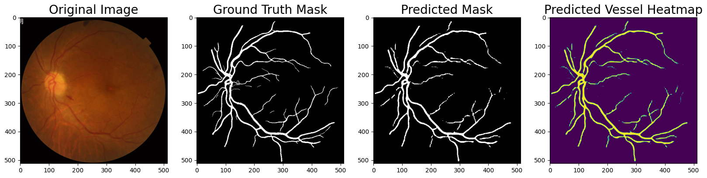
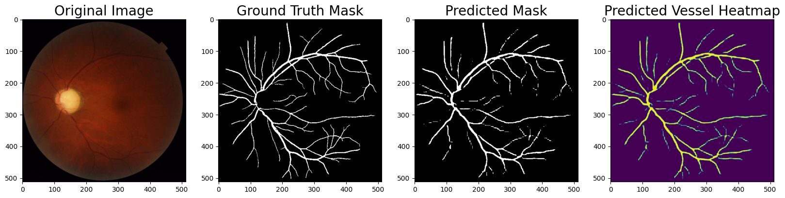
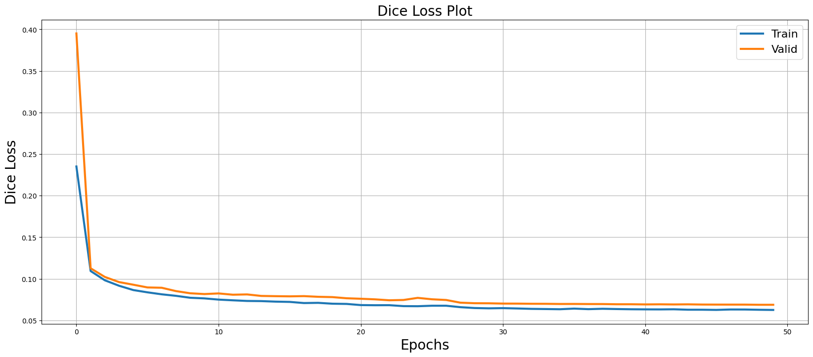

# Retinal vessel segmentation

Pixel-level segmentation of blood vessels in retinal fundus photographs. Vessel maps like these are the input for screening diabetic retinopathy and other conditions where the vascular structure changes.



## Result

| Metric (test split) | Value |
|---|---|
| IoU | **0.944** |
| Dice loss | 0.031 |



## Approach

- **Model:** DeepLabV3+ with a ResNet-101 encoder pre-trained on ImageNet ([segmentation-models-pytorch](https://github.com/qubvel/segmentation_models.pytorch))
- **Input:** fundus images resized to 512 × 512, masks one-hot encoded into background and vessel
- **Augmentation:** Albumentations — flips, shift / scale / rotate, elastic and grid distortion, perspective, CLAHE, gamma and brightness / contrast, blur, noise, colour shifts
- **Training:** Dice loss, Adam, 50 epochs, the best checkpoint kept by validation IoU



Validation loss tracks training loss closely through all 50 epochs, so the model is not overfitting the small training set.

## Run

```bash
uv sync
uv run jupyter lab vessel-segmentation.ipynb
```

Set the dataset path in the **Path** cell. The notebook covers data loading, training, evaluation on the test split and visualisation of predictions.

## Stack

PyTorch · segmentation-models-pytorch · Albumentations · OpenCV · NumPy · pandas · Matplotlib
